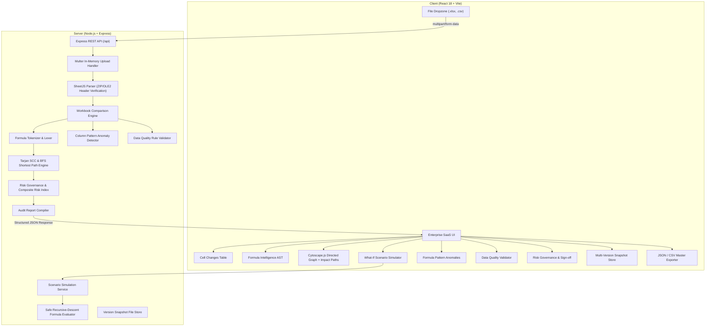

# WorkbookX — Enterprise Spreadsheet Intelligence & Change Risk Platform (v2.0)

> **WorkbookX** is an enterprise-grade spreadsheet change intelligence platform designed to compare two versions of Excel workbooks (`.xlsx`, `.xls`) or CSV files (`.csv`), detect cell and sheet modifications, tokenize and explain formula alterations, map multi-sheet calculation dependencies using directed graphs, detect circular references with Tarjan's Strongly Connected Components (SCC), simulate What-If scenarios with a safe recursive-descent parser, identify statistical column-pattern formula anomalies, validate data quality rules, manage multi-version snapshots, and enforce risk governance sign-offs.

---

## 1. Product Vision & Problem Statement

### The Problem
In financial planning, investment banking, tax reporting, and supply chain management, critical decisions rely on complex multi-sheet Excel models. When workbooks are updated across teams:
- Standard version control (like Git diffs) treats spreadsheets as opaque binaries (`.xlsx`) or flat unstructured text (`.csv`), showing no formula awareness.
- A formula alteration from `=B2-C2` to `=B2+C2` can silently invert operating income and inflate valuation models by millions of dollars.
- A dynamic formula replaced by a hardcoded constant (`1500`) silently eliminates dynamic model recalculations.
- Statistical anomalies (like a single cell in a column using a different formula pattern) go unnoticed.
- Circular references and `#REF!` errors slip into production models unnoticed.

### The Solution
WorkbookX parses spreadsheets cell-by-cell and sheet-by-sheet, lexically tokenizes formulas into Abstract Syntax Tree (AST) tokens, maps calculation dependencies in a directed acyclic graph (DAG), detects circular dependency loops with Tarjan's SCC and 3-color DFS, traces the downstream blast radius using Breadth-First Search (BFS), recalculates downstream cascades in a sandbox simulator, validates data quality rules, and computes a transparent, additive Composite Risk Index without stochastic AI or hallucinations.

---

## 2. System Architecture



---

## 3. Technology Stack

### Frontend
- **React 18**: Component-based user interface.
- **Vite 6**: Fast build tooling and Hot Module Replacement (HMR).
- **React Router 6**: Client-side routing across 12 application views.
- **Cytoscape.js**: Interactive directed graph visualization with pan, zoom, cycle highlighting, and impact path tracing.
- **Lucide React**: Clean, consistent icon set.
- **CSS3 Design Tokens**: Professional Inter typography, off-white slate palette, restrained indigo accents.
- **Vitest**: Unit testing for client utilities and formatters.

### Backend
- **Node.js (v20+ / v24)**: Non-blocking JavaScript runtime.
- **Express 4**: Clean, modular REST API.
- **SheetJS (`xlsx`)**: Safe spreadsheet extraction without macro execution.
- **Multer**: Controlled in-memory multipart upload handling with size capping (15MB).
- **Node.js Native Test Runner (`node:test`)**: High-performance, zero-dependency backend testing.

---

## 4. Project Directory Structure

```
WorkbookX/
|-- client/                              # Frontend React application
|   |-- src/
|   |   |-- components/
|   |   |   |-- Badge.jsx               # Reusable severity and change type badge
|   |   |   |-- DataTable.jsx           # Paginated, searchable data table
|   |   |   |-- EmptyState.jsx          # Polished empty state with action links
|   |   |   |-- FileDropzone.jsx        # Drag-and-drop file upload with validation
|   |   |   |-- LoadingState.jsx        # Processing spinner and step feedback
|   |   |   |-- Navbar.jsx              # Top header with active model indicator
|   |   |   |-- Sidebar.jsx             # Grouped navigation with live counters
|   |   |   |-- StatCard.jsx            # High-level metric summary card
|   |   |-- context/
|   |   |   |-- ComparisonContext.jsx   # Shared React state across all pages
|   |   |-- pages/
|   |   |   |-- OverviewPage.jsx        # Executive dashboard & 8 KPI cards
|   |   |   |-- NewComparisonPage.jsx   # File upload and 1-click sample presets
|   |   |   |-- ComparisonResultsPage.jsx# Cell-by-cell diff table with search & filters
|   |   |   |-- FormulaAnalysisPage.jsx # Formula AST inspection & operator diffs
|   |   |   |-- DependencyGraphPage.jsx # Interactive Cytoscape.js graph & Impact Path panel
|   |   |   |-- ScenarioSimulatorPage.jsx# What-If scenario simulation workspace
|   |   |   |-- FormulaAnomaliesPage.jsx# Statistical column pattern outliers
|   |   |   |-- DataQualityPage.jsx     # Configurable rules engine & findings table
|   |   |   |-- RiskFindingsPage.jsx    # Risk findings & Governance sign-off workflow
|   |   |   |-- VersionHistoryPage.jsx  # Multi-version snapshot store & snapshot diff
|   |   |   |-- AuditReportsPage.jsx    # Formal audit document & CSV/JSON export
|   |   |   |-- AboutSettingsPage.jsx   # System architecture & live API health ping
|   |   |-- services/
|   |   |   |-- api.js                  # Frontend API client
|   |   |-- styles/
|   |   |   |-- index.css               # Design system, CSS tokens, layout
|   |   |-- tests/
|   |   |   |-- formatters.test.js      # Frontend formatting unit tests
|   |   |-- utils/
|   |   |   |-- formatters.js           # String, date, and currency formatters
|   |   |-- App.jsx                     # Route definitions
|   |   |-- main.jsx                    # React entry point
|   |-- index.html
|   |-- package.json
|   |-- vite.config.js
|
|-- server/                              # Backend Express application
|   |-- controllers/
|   |   |-- comparisonController.js     # Upload, simulation, data quality & governance handlers
|   |-- routes/
|   |   |-- comparisonRoutes.js         # /api/compare, /api/scenario, /api/history routes
|   |   |-- healthRoutes.js             # /api/health route
|   |-- services/
|   |   |-- excelParserService.js       # Safe SheetJS extraction (cells, values, formulas)
|   |   |-- workbookComparisonService.js# Cell & sheet differential algorithm
|   |   |-- formulaIntelligenceService.js# Plain-language explanation & operator diffs
|   |   |-- dependencyGraphService.js   # Node/edge assembly & Cytoscape formatting
|   |   |-- impactAnalysisService.js    # Direct/indirect dependents & max depth
|   |   |-- scenarioSimulationService.js# What-If topological recalculator
|   |   |-- formulaAnomalyService.js    # Statistical column pattern outlier detector
|   |   |-- dataQualityService.js       # Non-negative, duplicate, required, range validator
|   |   |-- riskGovernanceService.js    # Decision workflow & Composite Risk Index (0-100)
|   |   |-- versionHistoryService.js    # File-based snapshot store (max 25 entries)
|   |   |-- riskEngineService.js        # Deterministic risk rules evaluator
|   |   |-- auditReportService.js       # Master audit JSON & CSV compiler
|   |-- utils/
|   |   |-- fileValidation.js           # Extension, size, and MIME validation
|   |   |-- formulaTokenizer.js         # Lexical tokenizer & cell range expander
|   |   |-- graphAlgorithms.js          # 3-color DFS cycle detector & BFS blast radius
|   |   |-- impactPathAlgorithms.js     # Tarjan's SCC & BFS shortest path algorithms
|   |   |-- safeFormulaEvaluator.js     # Recursive-descent AST evaluator (zero eval)
|   |-- tests/
|   |   |-- api.test.js                 # API endpoints & controller integration tests
|   |   |-- comparison.test.js          # Sheet & cell comparison tests
|   |   |-- formulaTokenizer.test.js    # Formula parsing & reference extraction tests
|   |   |-- graph.test.js               # Graph algorithms & cycle detection tests
|   |   |-- parser.test.js              # Excel & CSV parsing tests
|   |   |-- riskEngine.test.js          # Deterministic risk engine tests
|   |   |-- impactPath.test.js          # Tarjan SCC & BFS shortest path tests
|   |   |-- scenarioSimulator.test.js   # Safe evaluator & scenario tests
|   |   |-- formulaAnomaly.test.js      # Column pattern anomaly tests
|   |   |-- dataQuality.test.js         # Data quality validation tests
|   |   |-- versionHistory.test.js      # Snapshot create, list, compare tests
|   |   |-- riskGovernance.test.js      # Governance state machine & composite risk index tests
|   |-- server.js                       # Express server setup & middleware
|   |-- package.json
|
|-- sample-data/                         # Realistic pre-bundled spreadsheets
|   |-- generate-samples.js             # Generator script for test models
|   |-- Q3_Financial_Model_v1.xlsx      # Original multi-sheet financial model
|   |-- Q3_Financial_Model_v2.xlsx      # Modified model (flipped operator, constant, loop)
|   |-- Inventory_Forecast_Old.xlsx     # Original inventory projection
|   |-- Inventory_Forecast_New.xlsx     # Modified inventory (+ instead of -)
|   |-- Simple_Budget_A.csv             # Baseline tabular budget
|   |-- Simple_Budget_B.csv             # Updated tabular budget
|
|-- README.md                            # Comprehensive documentation
|-- .gitignore                           # Git ignore rules
|-- .env.example                         # Environment variables template
|-- package.json                         # Monorepo root scripts
```

---

## 5. Core Algorithms & How They Work

### A. Workbook Comparison Algorithm
1. **Sheet Matching**: Compares sheet names across workbooks to identify `Added Sheets`, `Removed Sheets`, and `Common Sheets`.
2. **Cell Union**: For every common sheet, constructs the union set of cell addresses present in either workbook.
3. **Change Classification**:
   - `ADDED`: Cell did not exist in original, exists in modified.
   - `REMOVED`: Cell existed in original, removed in modified.
   - `MODIFIED_VALUE`: Value changed while formula remains unchanged.
   - `FORMULA_CHANGED`: Formula expression modified between versions.
   - `FORMULA_REMOVED`: Dynamic formula replaced with a static constant (hardcoded override).
   - `FORMULA_ADDED`: Static value replaced with a formula.
4. **Tolerance**: Floating point numbers are compared with an epsilon ($\epsilon = 10^{-9}$) to prevent false diffs from precision noise.

### B. Formula Tokenizer & Reference Extractor
Rather than pretending to recalculate every Excel formula, WorkbookX uses a focused lexical tokenizer:
- Matches single cell references: `A1`, `$B$2`, `Sheet1!A1`, `'Sales Data'!C4`.
- Matches ranges: `B2:B5`, `'Revenue'!D4:D10`, expanding ranges into individual cell coordinates.
- Extracts mathematical and comparison operators: `+`, `-`, `*`, `/`, `^`, `=`, `<>`, `<`, `>`, `<=`, `>=`.
- Flags broken references: `#REF!`, `#VALUE!`, `#DIV/0!`.
- Detects operator flips: e.g. subtraction `-` inverted to addition `+`.

### C. Advanced Impact Path Intelligence (Tarjan SCC + BFS Shortest Path)
- **Tarjan's Strongly Connected Components (SCC)**: Discovers maximal subgraphs where every vertex is reachable from every other vertex. Strongly connected components with $>1$ node (or a self-loop) identify circular dependencies in $O(V + E)$ time.
- **BFS Shortest Dependency Path**: When an affected cell is selected, Breadth-First Search finds the exact shortest directed path from the changed root cell to the affected cell.
- **Direct vs. Indirect Dependents**: Direct dependents are cells at depth 1; indirect dependents are cells at depth $\ge 2$.
- **Downstream Depth**: Tracks the maximum calculation depth across the entire dependency cascade.

### D. Safe What-If Formula Evaluator (Zero `eval()`)
To prevent remote code execution, WorkbookX implements a pure recursive-descent parser and evaluator:
- Supported grammar:
  - Numbers: `1200`, `-3.5`
  - Cell lookups: `B2`, `Revenue!B2`, `'Sheet Name'!A1`
  - Binary operators: `+`, `-`, `*`, `/`, `^`
  - Parentheses: `(A1 + B1) * 2`
  - Functions: `SUM(range)`, `AVERAGE(range)`
- Division by zero returns `#DIV/0!`.
- Unrecognized or complex Excel functions (e.g. `XLOOKUP`, `INDEX`, `LAMBDA`) return `#UNSUPPORTED: <FUNCTION>` safely without crashing.

### E. Column Pattern Outlier Detection (Formula Anomalies)
In standard spreadsheets, formulas in a column share a consistent pattern (e.g. Row $i$ has `=B{i} * C{i}`). WorkbookX normalizes formulas by replacing row numbers with `{row}`.
- If $>70\%$ of formulas in a column share pattern $P$, any formula with pattern $Q \neq P$ is flagged as an **Anomaly** (`HIGH` confidence if column has $\ge 5$ cells, `MEDIUM` otherwise).
- If a cell inside a continuous column of formulas contains a static constant or is missing a formula, it is flagged as a **Broken Sequence**.

### F. Deterministic Data Quality Validator
Validates workbook values against deterministic business rules:
- `NON_NEGATIVE`: Verifies numeric values $\ge 0$.
- `REQUIRED`: Verifies that key columns have no empty or null cells.
- `RANGE`: Checks whether numeric values fall within `[min, max]`.
- `DUPLICATE`: Detects duplicate unique identifier values.

### G. Additive Composite Risk Score ($0 \le \text{Score} \le 100$)
WorkbookX uses a transparent, additive formula rather than a black-box machine learning model:
$$\text{RiskIndex} = \min(100, \text{BaseRisk} + \text{BlastRadiusPenalty} + \text{CyclePenalty} + \text{AnomalyPenalty} + \text{DQPenalty})$$
- Base Risk: Sum of finding weights (`CRITICAL`: 25, `HIGH`: 15, `MEDIUM`: 8, `LOW`: 3) capped at 50.
- Blast Radius Penalty: $\min(20, \lfloor\text{maxAffected} \times 2\rfloor)$.
- Cycle Penalty: $20$ if any circular references exist, else $0$.
- Anomaly Penalty: $\min(15, \text{anomaliesCount} \times 5)$.
- Data Quality Penalty: $\min(15, \text{dqFailuresCount} \times 3)$.
- Tiers: `0–25: LOW`, `26–50: MEDIUM`, `51–75: HIGH`, `76–100: CRITICAL`.

### H. Risk Governance State Machine
Findings move through a formalized sign-off workflow:
- `OPEN` $\to$ `UNDER_REVIEW` $\to$ `APPROVED` or `REJECTED` $\to$ `RESOLVED`.
- Every transition stores an audit log entry containing timestamp, reviewer identity, comment, and reason.

---

## 6. Installation & Quick Start

### Prerequisites
- **Node.js** (v20+ recommended, tested on v24)
- **npm** (v10+)

### Step 1: Clone Repository & Install Dependencies
```bash
git clone <repo-url>
cd workbookx

# Install backend and frontend dependencies
cd server && npm install
cd ../client && npm install
cd ..
```

### Step 2: Configure Environment Variables
Copy the example environment file:
```bash
cp .env.example .env
```
Default configuration:
```env
PORT=5000
NODE_ENV=development
CLIENT_URL=http://localhost:5173
MAX_FILE_SIZE_MB=15
```

### Step 3: Start the Backend Server
```bash
cd server
node server.js
```
The server will start at `http://127.0.0.1:5000`.

### Step 4: Start the Frontend Client
In a new terminal window:
```bash
cd client
npm run dev -- --host 127.0.0.1
```
The client will start at `http://127.0.0.1:5173`. Open your browser to explore the dashboard.

---

## 7. Running Automated Tests

WorkbookX includes **40 automated tests** (37 backend tests + 3 frontend tests) covering parsing, comparison, formula tokenization, graph algorithms, cycle detection, Tarjan SCC, safe evaluator, scenario simulation, anomalies, data quality, snapshot store, risk governance, and formatters.

### Run All Backend Tests (37 Tests)
```bash
cd server
npm test
```
*Expected Output:*
```
✔ Controller - compare-samples runs full comparison on Q3 financial models
✔ Controller - export/csv exports CSV table with risk and change headers
✔ Controller - export/json exports JSON report
✔ Controller - compare rejects missing files with 400
✔ Workbook Comparison - detects added and removed sheets
✔ Workbook Comparison - detects modified values and formula alterations
✔ Data Quality - detects unexpected negative value
✔ Data Quality - detects missing required field and duplicate keys
✔ Formula Anomaly - detects mathematical operator outlier in column sequence
✔ Formula Anomaly - detects missing formula / constant in formula column sequence
✔ Formula Tokenizer - tokenizes basic arithmetic formula
✔ Formula Tokenizer - extracts cross-sheet references
✔ Formula Tokenizer - expands cell range accurately
✔ Formula Tokenizer - extracts operators accurately
✔ Formula Tokenizer - detects broken reference #REF!
✔ Graph Algorithms - detects simple circular dependency A -> B -> A
✔ Graph Algorithms - finds downstream dependent blast radius
✔ Dependency Graph Service - builds Cytoscape elements for formula dependencies
✔ Tarjan SCC - identifies cyclic component and separates acyclic nodes
✔ Impact Paths - computes shortest path with BFS
✔ Impact Paths - classifies direct vs indirect dependents and max depth
✔ Impact Analysis Service - analyzes parsed workbook model with changes
✔ Excel Parser - successfully parses multi-sheet financial workbook
✔ Excel Parser - successfully parses CSV budget file
✔ Excel Parser - safely throws descriptive error on invalid corrupted file
✔ Risk Engine - triggers CRITICAL for circular dependency
✔ Risk Engine - triggers CRITICAL for broken reference #REF!
✔ Risk Engine - triggers HIGH for formula replaced with constant (hardcoding)
✔ Risk Engine - triggers HIGH for inverted arithmetic operator (- to +)
✔ Risk Governance - updates finding status with reviewer history
✔ Risk Governance - calculates transparent composite model risk score
✔ Safe Formula Evaluator - evaluates arithmetic expressions with cell lookups
✔ Safe Formula Evaluator - handles division by zero safely without crashing
✔ Safe Formula Evaluator - flags unsupported complex functions cleanly
✔ Scenario Simulator - recalculates downstream cascade when input changes
✔ Version History - creates and retrieves a named snapshot with hash
✔ Version History - compares two snapshots accurately
ℹ tests 37 | pass 37 | fail 0
```

### Run Frontend Unit Tests (3 Tests)
```bash
cd client
npm test
```
*Expected Output:*
```
✓ src/tests/formatters.test.js (3 tests)
Test Files  1 passed (1)
Tests       3 passed (3)
```

### Run All Tests via Root Scripts
```bash
npm run test:server
npm run test:client
```

---

## 8. API Endpoint Reference

| Method | Endpoint | Description | Request Payload | Response |
| :--- | :--- | :--- | :--- | :--- |
| `GET` | `/api/health` | Service health status | None | `{ status: "healthy", version: "1.0.0" }` |
| `POST` | `/api/compare` | Compare two uploaded workbooks | `multipart/form-data`: `original` & `modified` | Full comparison, graph, anomalies, DQ & risk JSON |
| `POST` | `/api/compare-samples` | Run comparison on bundled demo files | `{ "sampleKey": "financial" \| "inventory" \| "csv" }` | Full comparison, graph, anomalies, DQ & risk JSON |
| `POST` | `/api/scenario/simulate`| Simulate What-If input change | `{ "overrides": [{ "sheet", "cell", "simulatedValue" }] }` | Recalculated cells, affected paths & summary |
| `POST` | `/api/data-quality/validate` | Run custom data quality rules | `{ "rules": [...] }` | Passed/failed counts, pass rate & finding details |
| `GET` | `/api/history/snapshots` | List stored workbook snapshots | None | List of snapshot metadata and file hashes |
| `POST` | `/api/history/snapshots` | Save new comparison snapshot | `{ "name": "...", "description": "..." }` | Stored snapshot object with unique ID |
| `DELETE` | `/api/history/snapshots/:id` | Delete a stored snapshot | None | Deletion confirmation |
| `POST` | `/api/history/compare` | Compare two historical snapshots | `{ "snapshotIdA": "...", "snapshotIdB": "..." }` | Comparison diff between the two versions |
| `POST` | `/api/risk/decision` | Record risk review status/comment | `{ "riskId", "status", "reviewer", "comment" }` | Updated decision object and audit history |
| `POST` | `/api/export/csv` | Download CSV table of diffs & risks | `{ "changes": [...], "risks": [...], "extra": {...} }` | Downloadable `.csv` file attachment |
| `POST` | `/api/export/json` | Download master audit report JSON | `{ "report": { ... } }` | Downloadable `.json` file attachment |

---

## 9. Sample Workbooks Included

WorkbookX includes realistic sample spreadsheets located in `sample-data/`:
1. **`Q3_Financial_Model_v1.xlsx` vs `v2.xlsx`**:
   - Multi-sheet model (`Revenue`, `OpEx`, `Summary`, `Internal_Notes`, `Tax_Compliance`).
   - Inverted operating income formula: `=B2-B3` changed to `=B2+B3` (subtraction to addition).
   - Dynamic formula replaced with a hardcoded constant (`1500`).
   - Circular reference introduced in `Summary!B6` (`=B6*1.05`).
   - Broken `#REF!` reference introduced in `Summary!B7`.
2. **`Inventory_Forecast_Old.xlsx` vs `New.xlsx`**:
   - Stock balance formula changed: outbound sales added instead of subtracted (`=B2+C2+D2`).
3. **`Simple_Budget_A.csv` vs `B.csv`**:
   - Budget department additions, removals, and value modifications.

---

## 10. Honest Disclosures & Known Scope Boundaries

- **Supported Formula Evaluator Subset**: Arithmetic operators (`+`, `-`, `*`, `/`, `^`), unary minus, cell references (`A1`, `Sheet!A1`), parentheses, `SUM(range)`, and `AVERAGE(range)`. Complex functions like `XLOOKUP`, `INDEX/MATCH`, `LAMBDA`, and dynamic arrays are detected and flagged as `#UNSUPPORTED`, not evaluated.
- **VBA Macros**: Macro execution is explicitly disabled for security. WorkbookX evaluates static formula syntax and values, never executing Visual Basic code.
- **External Connections**: External database links (ODBC/SQL queries) and web data feeds embedded in workbooks are not queried at runtime.
- **Deterministic Risk Heuristics**: Risk findings highlight potential logic discrepancies to guide human review; they are transparent warnings, not guaranteed financial calculations or legal audit certifications.
- **Single-User Version History**: Version history snapshots are stored in local JSON files (`server/data/snapshots.json`) designed for single-node development and demonstration, not distributed multi-tenant production databases.
- **Print PDF Export**: Export to PDF is supported via the browser's native Print dialog (`window.print()`). Dedicated headless PDF rendering (e.g. Puppeteer) is omitted to keep the stack lightweight.

---

## 11. Production Build Verification

To create an optimized production build of the frontend:
```bash
cd client
npm run build
```
Built artifacts are stored in `client/dist/` ready to be served by any static host or Express production middleware.

---

## License
MIT License. Created for educational and enterprise spreadsheet change intelligence.
